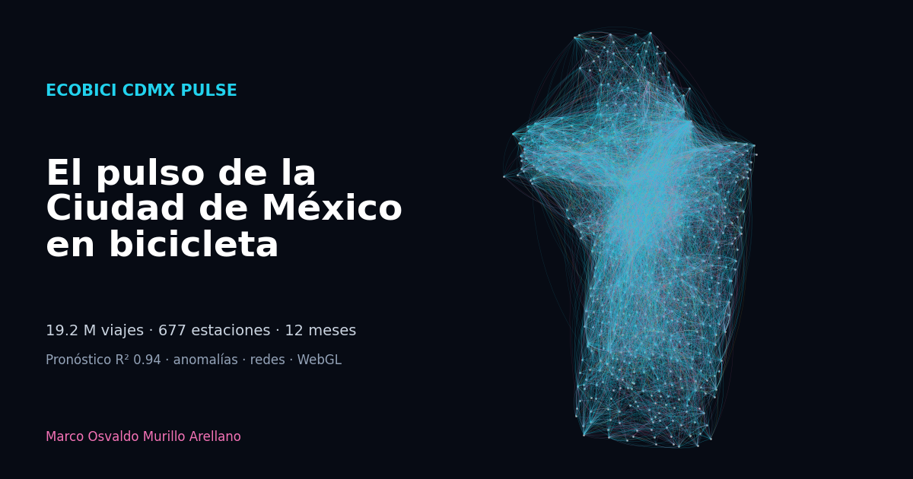

# Ecobici CDMX Pulse

**Big-data analytics and interactive storytelling on 12 months of Mexico City's public bike system.**

[](https://github.com/Osvaldo6242/ecobici-cdmx-pulse/actions/workflows/ci.yml)


[](https://osvaldo6242.github.io/ecobici-cdmx-pulse/)

### 👉 [Open the interactive story](https://osvaldo6242.github.io/ecobici-cdmx-pulse/)

> 🇪🇸 [Resumen en español](#resumen-en-español) más abajo.

| 19.1 M trips | 677 stations | 365 days | 122 s end-to-end | R² 0.95 (CV) | −42 % error vs baseline |
|---|---|---|---|---|---|

An end-to-end pipeline that turns **12 monthly open-data dumps (~1.2 GB of CSV)** into a Parquet lake,
a layered **DuckDB** warehouse, forecasting / anomaly / clustering / network models, and a
**scroll-driven WebGL story** with animated trips, 3D demand columns and flow arcs.

---

## What's inside

| Layer | What it does | Where |
|---|---|---|
| **Ingestion** | Resumable download of 12 official monthly CSVs (~1.2 GB), GBFS station catalogue, hourly weather (ERA5) and air quality (CAMS) from Open-Meteo | `pipeline/pulse/ingest.py` |
| **Data lake** | Typed, zstd-compressed **Parquet** per month, written by DuckDB straight from CSV | `data/lake/` |
| **Warehouse** | **DuckDB** with dbt-style SQL layers: `staging` (typing + validity reason per row) → `intermediate` (calendar, holidays, haversine distances) → `marts` (hourly, daily, station profiles, OD matrix, rebalancing, riders, data quality) | `pipeline/pulse/sql/` |
| **Forecasting** | Hourly demand: seasonal-naive vs Ridge vs **Poisson gradient boosting** with calendar, holiday, weather, air-quality and autoregressive features; **rolling-origin** validation; 4-week hold-out; rain counterfactual | `forecast.py` |
| **Anomaly detection** | Week-blocked out-of-fold predictions for every hour → daily residuals → robust (median/MAD) z-scores, auto-explained by holidays or heavy rain | `anomalies.py` |
| **Clustering** | K-means on 48-dim normalised 24h departure/arrival profiles, k chosen by silhouette, rule-based archetype naming | `stations.py` |
| **Network science** | Directed OD graph, PageRank, **Louvain** communities and modularity (NetworkX) | `stations.py` |
| **Operations** | Rebalancing pressure: cumulative net flow vs dock capacity per station | `stations.py` |
| **Privacy** | Only aggregates are published; demographic cells < 100 trips suppressed | `riders.py` |
| **Web** | Scrollytelling site: **deck.gl** TripsLayer / ColumnLayer / ArcLayer on **MapLibre**, **D3** charts, **Scrollama** | `docs/` |
| **Engineering** | 14 pytest tests on a synthetic mini-system, Dockerfile, Makefile, GitHub Actions CI + automatic Pages deploy | `tests/`, `.github/` |

---

## Key findings (June 2025 – May 2026)

1. **Data quality is excellent but not perfect.** 19,157,949 raw rows; 99.94 % valid. 7,782 trips
   over 3 h, 2,330 under 1 min and 1,056 with unknown stations are rejected with an explicit reason.
2. **The city has two heartbeats.** Working-day demand peaks at **18:00** and **08:00**; weekends are
   flatter and later. The representative dry Wednesday animated on the site (6 May 2026) carried 64,143 trips.
3. **Demand is highly predictable.** Poisson gradient boosting reaches **R² = 0.95** in rolling-origin CV
   (MAE 213 trips/h vs 371 for seasonal-naive, **−42 %**) and **R² = 0.94** on a 4-week hold-out.
4. **Rain costs ~16 % of trips** in the hours it falls (model counterfactual); 1–3 mm already cuts
   demand to ~78 % of an equivalent dry hour.
5. **Air pollution does *not* deter riders.** A naive average suggests more trips on bad-air hours;
   controlling for time of day, the effect disappears (≈ 100 %) — a textbook confounder.
6. **22 anomalous days** (|z| ≥ 3): Christmas −63 %, New Year −46 %, storms, winter break — and
   **Dec 12 (Virgen de Guadalupe) +80 %**, the biggest positive shock of the year.
7. **Three station archetypes** emerge from 24-h profiles: *origen residencial* (empties at 8 h),
   *destino laboral* (fills at 8 h, empties at 18 h) and *uso mixto*; they are geographically coherent.
8. **Four "cycling neighbourhoods"** (Louvain, modularity 0.46): most trips stay inside a community.
9. **Rebalancing hot-spots**: the busiest double station accumulates a net surplus of ~5× its
   dock capacity on an average working day.
10. **Gender gap**: women make **29 %** of trips; their share peaks at 07:00 (30 %) and drops to 18 % after midnight.

---

## Architecture

```
 ecobici.cdmx.gob.mx ─┐   GBFS stations ─┐   Open-Meteo (weather, air) ─┐
                      ▼                  ▼                              ▼
              ingest.py ── CSV → Parquet lake (zstd, 1 file / month)
                      │
                      ▼
              DuckDB warehouse
              ├─ 01_staging.sql        typed trips + validity reason
              ├─ 02_intermediate.sql   valid trips, calendar, holidays, distances
              └─ 03_marts.sql          hourly · daily · station profiles · OD · rebalancing · riders · DQ
                      │
     ┌────────────────┼─────────────────┬───────────────┬──────────────┐
     ▼                ▼                 ▼               ▼              ▼
 forecast.py     anomalies.py      stations.py      riders.py     export_web.py
 (GBM, CV)       (robust z)        (k-means,        (k-anon       (compact JSON)
                                    Louvain, flow)   aggregates)        │
                                                                        ▼
                                              docs/  →  GitHub Pages (deck.gl + D3)
```

## Run it

```bash
python -m venv .venv && source .venv/bin/activate
make install
make pipeline     # downloads ~1.2 GB, builds everything (≈ 1–2 min after download)
make serve        # http://localhost:8000
make test         # 14 tests, < 2 s
```

## Limitations

* Trips are drawn as arcs between stations: the open data has no GPS tracks.
* Weather and air quality come from reanalysis/forecast models at one point for the city,
  not from street-level sensors.
* Gender/age are self-reported at registration; "O/ND" groups other and missing values.
* Rebalancing pressure uses average flows; real operations already move bikes by truck.

## Data & credits

Ecobici CDMX open data · Open-Meteo (ERA5, CAMS) · Map © OpenStreetMap contributors © CARTO.

---

## Resumen en español

**Ecobici CDMX Pulse** analiza **19,1 millones de viajes reales** del sistema de bicicletas públicas de la
Ciudad de México (junio 2025 – mayo 2026) con un pipeline de big data y los cuenta en una
**historia interactiva**: viajes animados sobre el mapa, columnas 3D de demanda hora por hora y arcos de flujos.

**Hallazgos:** la demanda es muy predecible (R² 0,95; 42 % menos error que el baseline); la lluvia resta
~16 % de los viajes; la contaminación no frena a los ciclistas (una correlación engañosa que se corrige
controlando la hora); 22 días anómalos detectados (Navidad −63 %, Virgen de Guadalupe +80 %);
3 arquetipos de estación, 4 comunidades ciclistas y una brecha de género (29 % mujeres).

**Habilidades:** ingeniería de datos (Parquet, DuckDB, SQL en capas), calidad de datos, series de tiempo y
machine learning, detección de anomalías, clustering, ciencia de redes, privacidad, visualización WebGL
(deck.gl, MapLibre, D3), scrollytelling, pruebas automatizadas, Docker y CI/CD con despliegue en GitHub Pages.

---

**Autor:** Marco Osvaldo Murillo Arellano ·
[LinkedIn](https://www.linkedin.com/in/murillo-arellano-marco-osvaldo-942b9428b/) · MIT License
